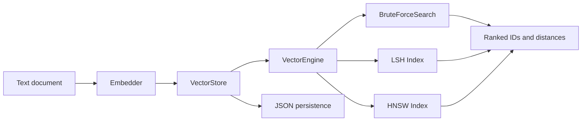

# Educational Vector Search Engine

[](https://www.python.org/)
[](https://www.sbert.net/)
[](https://pytest.org/)
[](#project-status)

An educational Python vector search engine built incrementally across 13 phases. The project explores vector representations, text embeddings, storage, exact nearest-neighbor retrieval, approximate indexing, metadata filtering, persistence, and reproducible benchmarking.

## Features

- Custom `Vector` representation and Euclidean distance.
- `VectorStore` with integer document IDs, original text, metadata, and JSON persistence.
- Text embeddings through `SentenceTransformer("all-MiniLM-L6-v2")`.
- Exact brute-force top-k search.
- Approximate random-hyperplane LSH search.
- Approximate graph-based HNSW search.
- Exact-match metadata filtering with AND semantics.
- High-level `VectorEngine` API for ingestion, search, and persistence.
- Synthetic benchmarks for latency, throughput, index build time, and Recall@k.
- Recursive directory ingestion through `vec.py`.

## Architecture

Documents are embedded before being stored. Search embeds a text query, obtains either all IDs or approximate candidate IDs, calculates exact Euclidean distances for those candidates, applies metadata filters, and returns ranked results.



Main modules:

- `src/vector.py`: minimal vector wrapper.
- `src/similarity.py`: Euclidean distance.
- `src/storage.py`: vectors, documents, metadata, and JSON save/load.
- `src/embedding.py`: SentenceTransformer adapter.
- `src/search.py`: candidate retrieval, exact distance ranking, filters, and document lookup.
- `src/index.py`: one-table random-hyperplane LSH.
- `src/hnsw.py`: educational incremental HNSW graph.
- `src/engine.py`: unified public API.
- `benchmarks/benchmark_search.py`: deterministic synthetic benchmark runner.

## Requirements

- Python 3.11 or newer.
- Runtime dependency: `sentence-transformers` for the default text embedder.
- Development dependency: `pytest` for the test suite.

The benchmark and tests use synthetic vectors or fake embedders and do not require model downloads. Constructing `VectorEngine()` without an injected embedder does require the runtime embedding dependency and may download the configured SentenceTransformer model on first use.

## Installation

From a checkout of this repository:

```bash
python -m venv .venv
source .venv/bin/activate
python -m pip install --upgrade pip
python -m pip install -e ".[dev]"
```

On Windows PowerShell, activate with:

```powershell
.venv\Scripts\Activate.ps1
```

No repository URL is specified here because this local project does not declare one.

## Quick Start

To ingest every UTF-8-readable file in a directory and search it interactively:

```bash
python vec.py folder1/
```

Run one query and optionally save the JSON store:

```bash
python vec.py folder1/ --index hnsw --query "how is authentication configured?" --save vectors.json
```

The CLI walks nested directories in deterministic path order, skips blank files,
and records each file's relative path, extension, and size as metadata. Use
`--index brute`, `--index lsh`, or `--index hnsw`; brute force is the default.

The normal API uses the SentenceTransformer embedder:

```python
from src.engine import VectorEngine

engine = VectorEngine(index_type="hnsw", index_kwargs={"seed": 7})
engine.add_document(
    "Python is a programming language.",
    metadata={"category": "programming", "language": "python"},
)
engine.add_document(
    "Vector search ranks records by distance.",
    metadata={"category": "search", "language": "python"},
)

results = engine.search(
    "What is Python?",
    k=5,
    filters={"category": "programming"},
)
for vector_id, distance in results:
    print(vector_id, distance)

engine.save("vectors.json")
loaded = VectorEngine(index_type="hnsw", index_kwargs={"seed": 7})
loaded.load("vectors.json")
print(loaded.search("What is Python?", k=1))
```

`add_document()` returns the assigned integer ID. `search()` returns `(vector_id, distance)` pairs ordered by ascending Euclidean distance. `search_text()` returns `(original_document_text, distance)` pairs.

For tests or offline experiments, inject an object with an `embed(text)` method returning a `Vector`; this avoids loading the embedding model.

## Search Strategies

`VectorEngine(index_type=None)` uses exact brute-force search. Every stored vector is considered, so the result is the exact nearest-neighbor ranking for the selected candidates and filters.

`VectorEngine(index_type="lsh", index_kwargs={...})` uses the Phase 8 random-hyperplane LSH index. Queries inspect only the matching hash bucket. LSH is approximate and can return fewer than `k` results or miss eligible records. The engine rebuilds the LSH buckets after each new document.

`VectorEngine(index_type="hnsw", index_kwargs={...})` uses the Phase 9 hierarchical graph index. New documents are inserted incrementally, and the graph is rebuilt after loading persisted data. HNSW is approximate; recall depends on graph and search parameters and is not guaranteed to equal brute force.

Both approximate indexes pass candidate IDs to `BruteForceSearch`, which calculates exact distances for discovered candidates. Metadata filters are applied to those candidates; filtered ANN searches can therefore have lower recall than unfiltered searches.

## Metadata Filtering

Filters use exact values and AND semantics:

```python
results = engine.search(
    "beginner Python material",
    k=5,
    filters={"category": "programming", "language": "python"},
)
```

Every requested key must exist in a record's metadata and equal the requested value. `filters=None` and `{}` disable filtering. Numeric ranges, nested expressions, OR queries, and other filter languages are not implemented.

## Persistence

`VectorStore.save()` writes vectors, documents, metadata, and `next_id` to JSON. `VectorStore.load()` also accepts older JSON files without a metadata field and assigns `{}` metadata to those records.

Index structures are not persisted. `VectorEngine.load()` restores the store and constructs the configured LSH or HNSW index again. Use the same index configuration when loading if reproducible index behavior is desired.

## Benchmarking

Run the default synthetic benchmark with:

```bash
python benchmarks/benchmark_search.py
```

A small smoke configuration is:

```bash
python benchmarks/benchmark_search.py --size 30 --dimension 3 --queries 5 --k 4 --seed 2
```

Available options include `--size`, `--dimension`, `--queries`, `--k`, `--seed`, `--lsh-planes`, `--hnsw-m`, `--hnsw-ef-construction`, and `--hnsw-ef-search`.

The report uses the same deterministic synthetic dataset and queries for each strategy and includes:

- Build time: index construction time; brute force is shown as `0.000` because it has no index build step.
- Mean and median latency: per-query search time in milliseconds.
- Throughput: total measured queries divided by total measured search time.
- Recall@k: overlap between approximate and exact top-k IDs, divided by the number of available exact results.

Synthetic Gaussian vectors are useful for repeatable comparisons but do not represent every real embedding workload. Timing results vary by machine and Python runtime.

Measured example (synthetic dataset: 1,000 vectors, 16 dimensions, 100 queries,
`k=10`, seed 42; run on the development machine):

| Strategy | Build time (ms) | Mean latency (ms) | Median latency (ms) | Throughput (q/s) | Recall@k |
| --- | ---: | ---: | ---: | ---: | ---: |
| Brute force | 0.000 | 9.602 | 9.292 | 104.2 | 1.000 |
| LSH | 33.489 | 0.122 | 0.109 | 8,185.4 | 0.062 |
| HNSW | 6,861.106 | 3.974 | 3.612 | 251.6 | 0.969 |

These are illustrative measurements, not guarantees. The synthetic workload,
Python runtime, machine, and ANN parameters materially affect the results.

## Testing

Install the development extra, then run:

```bash
python -m compileall src tests benchmarks
python -m pytest tests/test_engine.py -v
python -m pytest -v
```

Tests use deterministic vectors and fake embedders where appropriate, so the suite does not need to download an embedding model.

## Limitations

- LSH uses one exact-match hash bucket and can have poor recall.
- HNSW is intentionally compact and educational, not production-ready.
- Approximate indexes can return fewer than `k` records and can miss true nearest neighbors.
- Filtered ANN recall can be lower because filtering occurs after candidate discovery.
- Index graphs and LSH buckets are in-memory and rebuilt after loading.
- JSON persistence is simple and not designed for concurrent writes or large-scale deployment.
- The default SentenceTransformer embedder may require model download and substantial runtime resources.
- Benchmarks are synthetic and do not establish production performance guarantees.
- There is no HTTP API, UI, metadata range filtering, or benchmarking persistence layer.

## Project Status

The 13 planned phases are documented as educational components:

1. Vector foundations
2. Vector storage
3. Brute-force search
4. Top-k retrieval
5. Text embeddings and ingestion
6. JSON persistence
7. Index abstraction
8. LSH approximate search
9. HNSW approximate search
10. Metadata filtering
11. Unified `VectorEngine` API
12. Benchmarking and Recall@k measurement
13. Documentation and final validation (documentation and compile/benchmark checks complete; the full test suite still requires a pytest-enabled environment)

The project is complete as a learning implementation. Production concerns such as durable index formats, concurrent access, distributed operation, advanced filtering, and service APIs remain intentionally out of scope.
