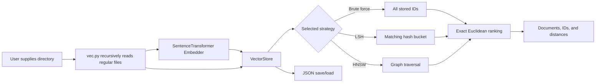

# Vecna

## Vector Engine for Contextual and Nearest-neighbor Analysis

**Search Beyond Words.**

[](https://www.python.org/)
[](https://www.sbert.net/)
[](https://pytest.org/)
[](#project-status)

Vecna is an educational Python vector search engine. It converts text into numerical embeddings, stores those vectors alongside the original documents, and retrieves semantically related documents by comparing vector representations.

Repository: [github.com/st4ckrift/Vector-Engine](https://github.com/st4ckrift/Vector-Engine)

## Overview

Traditional keyword search looks for literal terms. A query such as `how do I fix a slow program?` may not match a document containing `performance troubleshooting` unless the words overlap. Semantic search compares embeddings instead, so related meanings can be near each other even when their wording differs.

Vecna's semantic relevance comes from the configured embedding model, currently `sentence-transformers` with `all-MiniLM-L6-v2`. Vector search ranks documents; it does not generate answers or provide a chat/completion model.

## Features

- User-provided text document ingestion.
- Recursive directory ingestion with `vec.py`.
- SentenceTransformer text embeddings.
- Nearest-neighbor retrieval using Euclidean distance.
- Exact brute-force search.
- Approximate random-hyperplane LSH search.
- Approximate graph-based HNSW search.
- Exact-match metadata filters with AND semantics.
- JSON persistence for vectors, documents, metadata, and IDs.
- A high-level `VectorEngine` Python API.
- Synthetic benchmarking for build time, latency, throughput, and Recall@k.

## Architecture

The CLI accepts a directory, recursively reads regular files as UTF-8 text, embeds non-blank content, and stores each record. A query is embedded with the same model. The selected strategy produces either all vector IDs or approximate candidate IDs; `BruteForceSearch` then calculates exact Euclidean distances for those candidates and returns ranked documents.



### Modules

- `vec.py`: command-line directory ingestion and search.
- `src/vector.py`: lightweight `Vector` wrapper around numeric values.
- `src/similarity.py`: Euclidean distance implementation.
- `src/storage.py`: vector IDs, document text, metadata, and JSON persistence.
- `src/embedding.py`: `SentenceTransformer("all-MiniLM-L6-v2")` adapter.
- `src/search.py`: candidate retrieval, metadata filtering, exact distance calculation, and top-k ranking.
- `src/index.py`: single-table random-hyperplane LSH index.
- `src/hnsw.py`: in-memory educational HNSW graph.
- `src/engine.py`: unified ingestion, search, indexing, and persistence API.
- `benchmarks/benchmark_search.py`: deterministic synthetic benchmark runner.

## Installation

Vecna requires Python 3.11 or newer. The default embedding path requires `sentence-transformers`; tests and synthetic benchmarks use deterministic vectors or fake embedders and do not need a model download.

```bash
git clone git@github.com:st4ckrift/Vector-Engine.git
cd Vector-Engine
python -m venv .venv
source .venv/bin/activate
python -m pip install --upgrade pip
python -m pip install -e ".[dev]"
```

On Windows PowerShell:

```powershell
.venv\Scripts\Activate.ps1
python -m pip install -e ".[dev]"
```

The first normal use of `VectorEngine()` may download the `all-MiniLM-L6-v2` model through SentenceTransformers. No environment variables are required by the current implementation.

## Directory CLI

The primary CLI is argument-based:

```bash
python vec.py folder1/
```

This command:

1. Verifies that `folder1/` is a directory.
2. Recursively visits every regular file below it in sorted path order.
3. Reads each file as UTF-8 with replacement for undecodable bytes.
4. Skips files whose content is blank after whitespace trimming.
5. Embeds and stores each remaining file.
6. Starts an interactive prompt for text queries.

The current CLI does not filter by extension: every regular file is attempted as text. It does not deduplicate files, delete records, watch for changes, or automatically synchronize later directory edits. Re-run ingestion to create a new in-memory collection. Unreadable files are not explicitly skipped; filesystem errors can stop ingestion, while invalid UTF-8 bytes are replaced.

Each ingested record receives metadata containing `path`, lowercase `extension`, and `size_bytes`. The CLI prints document previews and distances, not source paths, in search results.

### CLI options

```bash
python vec.py folder1/ --index brute -k 5
python vec.py folder1/ --index lsh --query "configuration troubleshooting" --save vectors.json
python vec.py folder1/ --index hnsw -k 10 --query "database connection settings"
```

- `--index`: `brute` (default), `lsh`, or `hnsw`.
- `-k`: number of results; default `5`.
- `--query`: run one query and exit instead of opening the prompt.
- `--save`: write the ingested store to a JSON file.

At the interactive prompt, type a query and press Enter. Press Ctrl-D or Ctrl-C to exit. `--save` saves after ingestion; it does not establish a watch or incremental reload workflow. The CLI has no `--load` option, so reuse an existing JSON collection through the Python API.

### End-to-end example

Given:

```text
notes/
├── databases.txt
└── python/
    └── performance.md
```

Run:

```bash
python vec.py notes/ --index hnsw --query "how can I troubleshoot a slow Python program?" -k 2
```

Illustrative output (the exact text and distances depend on the embedding model):

```text
Ingested 2 files from notes
0.742381  Profiling and performance techniques for Python programs...
1.183902  Database connection troubleshooting notes...
```

## Python API

`VectorEngine` accepts `index_type=None`, `"lsh"`, or `"hnsw"`. Its default embedder loads SentenceTransformers. `add_document()` returns an integer ID, `search()` returns `(vector_id, distance)` pairs, and `search_text()` returns `(document_text, distance)` pairs.

```python
from src.engine import VectorEngine

engine = VectorEngine(index_type="hnsw", index_kwargs={"seed": 42})
engine.add_document(
    "Python performance troubleshooting guide",
    metadata={"topic": "python", "kind": "guide"},
)
engine.add_document(
    "Database connection troubleshooting guide",
    metadata={"topic": "database", "kind": "guide"},
)

for vector_id, distance in engine.search(
    "slow Python program", k=5, filters={"topic": "python"}
):
    print(vector_id, distance)

for document, distance in engine.search_text("slow Python program", k=1):
    print(document, distance)

engine.save("vectors.json")
loaded = VectorEngine(index_type="hnsw", index_kwargs={"seed": 42})
loaded.load("vectors.json")
```

For tests or offline examples, inject an object exposing `embed(text)` and returning `Vector` objects. This avoids loading the embedding model.

## Search Strategies

### Brute force

`index_type=None` considers every stored vector, calculates Euclidean distance, sorts by ascending distance, and returns the first `k` records. It is the exact baseline for this implementation. Its work grows with the number of stored vectors.

### LSH

`index_type="lsh"` uses random hyperplanes to assign vectors to one hash bucket. A query checks only its exact matching bucket. This can reduce query work, but a single bucket provides no recall guarantee and may return fewer than `k` records. LSH buckets are rebuilt after each CLI/API insertion by the engine.

### HNSW

`index_type="hnsw"` uses an in-memory hierarchical graph. Search greedily traverses upper layers and performs bounded exploration at layer 0. HNSW supports incremental insertion and generally explores more structure than the single-bucket LSH implementation, but construction is more expensive and results remain approximate.

All strategies use Euclidean distance from `src/similarity.py`; lower distance means closer vectors. LSH and HNSW return candidate IDs, after which the existing searcher calculates exact distances only for discovered candidates. Metadata filters are applied to those candidates, so filtered approximate search can miss eligible documents.

## Persistence and Data Handling

`VectorStore.save(path)` writes JSON containing `next_id`, vector values, original documents, and metadata. `load(path)` restores integer IDs and accepts older files without a metadata field by assigning `{}` metadata.

The indexes themselves are not persisted. `VectorEngine.load()` restores the store and rebuilds the configured LSH or HNSW index in memory. Use the same `index_type` and compatible `index_kwargs` when loading if you want the same strategy configuration. The source directory is not tracked or synchronized; changes require another explicit ingestion run. There is no duplicate detection or document deletion API.

## Performance Benchmarks

The benchmark compares all strategies against the same generated dataset and query vectors. Synthetic vectors are generated with a fixed seed, and exact brute-force results provide ground truth.

Run the benchmark with:

```bash
python benchmarks/benchmark_search.py --size 100 --dimension 8 --queries 20 --k 5 --seed 42
python benchmarks/benchmark_search.py --size 500 --dimension 16 --queries 30 --k 10 --seed 42
```

Relevant options are `--size`, `--dimension`, `--queries`, `--k`, `--seed`, `--lsh-planes`, `--hnsw-m`, `--hnsw-ef-construction`, and `--hnsw-ef-search`.

Metrics:

- **Build time:** index construction time; brute force has no build step and is reported as zero.
- **Mean/median latency:** per-query search time in milliseconds.
- **Throughput:** measured query count divided by total query execution time.
- **Recall@k:** overlap between approximate and exact top-k IDs divided by the number of available exact results.
- **p95 latency:** calculated internally by the runner but not printed in its current table.

### Measured results

Environment: Python 3.14.7 on the local development environment. The benchmark does not record hardware details. Each row below was produced by the command shown above with seed `42` and default LSH/HNSW parameters.

| Dataset | Strategy | Build (ms) | Mean (ms) | Median (ms) | Queries/s | Recall@k |
| ---: | --- | ---: | ---: | ---: | ---: | ---: |
| 100 x 8, 20 queries, k=5 | Brute force | 0.000 | 0.682 | 0.709 | 1,465.6 | 1.000 |
| 100 x 8, 20 queries, k=5 | LSH | 2.612 | 0.038 | 0.038 | 26,074.5 | 0.060 |
| 100 x 8, 20 queries, k=5 | HNSW | 134.136 | 0.764 | 0.742 | 1,308.8 | 1.000 |
| 500 x 16, 30 queries, k=10 | Brute force | 0.000 | 3.863 | 3.825 | 258.9 | 1.000 |
| 500 x 16, 30 queries, k=10 | LSH | 18.117 | 0.073 | 0.060 | 13,721.1 | 0.053 |
| 500 x 16, 30 queries, k=10 | HNSW | 1,600.406 | 1.572 | 1.532 | 635.9 | 0.977 |

These are local measurements, not guarantees. On these synthetic runs, LSH had the lowest query latency but poor recall, while HNSW retained much higher recall at a larger build cost. Real text collections, embedding distributions, machine hardware, and index parameters can produce different results.

## Testing

Install the development extra, then run:

```bash
python -m compileall src tests benchmarks vec.py
python -m pytest tests/test_engine.py -v
python -m pytest -v
```

The tests cover vector storage and persistence, metadata filtering, LSH and HNSW graph behavior, engine ingestion/search, deterministic benchmark calculations, directory ingestion, and the existing SSH monitor modules. The current environment did not have `pytest` installed, so the test commands must be run after installing the `[dev]` extra.

## Limitations and Future Work

- The CLI treats every regular file as text; there is no extension allowlist, parser for PDFs/binary formats, or chunking for large files.
- Invalid UTF-8 bytes are replaced; other filesystem read errors can stop ingestion.
- Directory changes are not synchronized automatically, and there is no duplicate or deletion handling.
- LSH checks one exact bucket and can have very low recall.
- HNSW is a compact educational implementation, not a production index.
- Approximate searches can return fewer than `k` results or miss true nearest neighbors.
- Filtered approximate search can miss records because filtering happens after candidate discovery.
- Vectors and documents persist as simple JSON, but index structures are rebuilt and JSON is not designed for concurrent or large-scale storage.
- The default embedding model requires SentenceTransformers and may download model files on first use.
- Benchmarks use synthetic vectors and do not predict every real workload.
- There is no HTTP API, background file watcher, document deletion API, advanced filter language, or answer-generation layer.

## Project Status

Vecna is an educational, runnable implementation of a vector search engine. The core CLI, Python API, storage, indexes, metadata filters, tests, and benchmark runner are present. Full test execution still depends on installing the declared development dependency `pytest` in the active environment.
